# DryRun

DryRun is a native iPhone app that helps families prepare for emergencies and practice using their own household information and home layout.

- Prepare for home fires, tornadoes, flash floods, freezing weather, extreme heat, and water outages.
- Record family members, assistance needs, medications, equipment, contacts, and supplies.
- Create a home manually or scan with RoomPlan on a supported LiDAR device.
- Find nearby resources and plan meeting places with maps.
- Build a shopping list from supply gaps and track preparation and practice evidence.
- Use Beacon for optional personalized AI assistance.
- Keep family cards and plans locally, export PDFs, and use English, Spanish, or Vietnamese.

## Screenshots

Demo screens from the app. Select an image to view it at full size.

<table>
  <tr>
    <td align="center" valign="top" width="33%">
      <a href="docs/images/IMG_6849.PNG">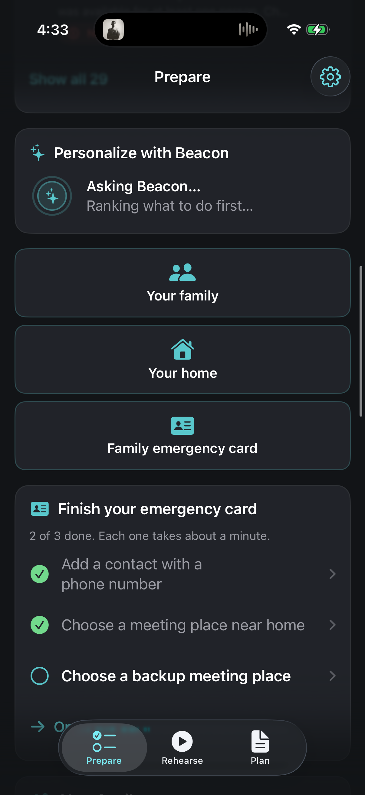</a>
      <br><strong>Prepare</strong>
      <br>Family setup, emergency-card tasks, and optional Beacon personalization.
    </td>
    <td align="center" valign="top" width="33%">
      <a href="docs/images/IMG_6857.PNG">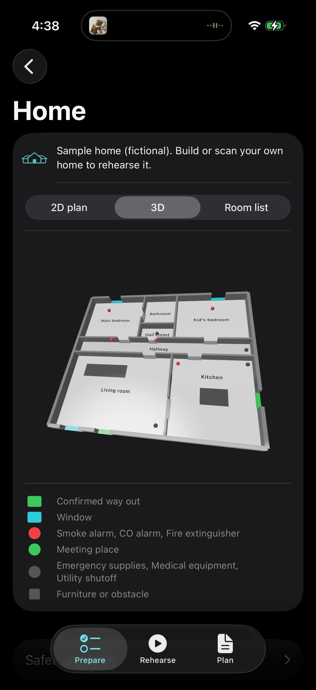</a>
      <br><strong>Your home in 3D</strong>
      <br>Explore the example home with rooms, exits, windows, and recorded supplies.
    </td>
    <td align="center" valign="top" width="33%">
      <a href="docs/images/IMG_6858.PNG">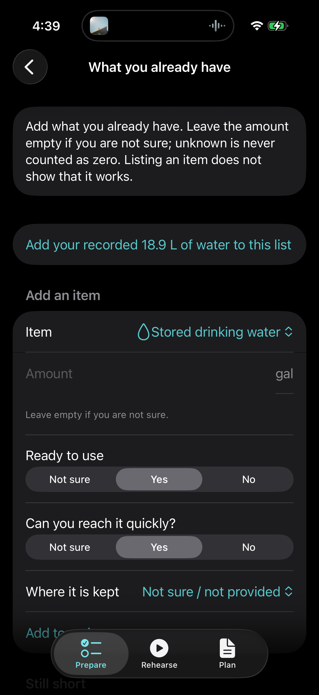</a>
      <br><strong>Household supplies</strong>
      <br>Record quantities, readiness, reachability, and where supplies are kept.
    </td>
  </tr>
  <tr>
    <td align="center" valign="top" width="33%">
      <a href="docs/images/IMG_6859.PNG">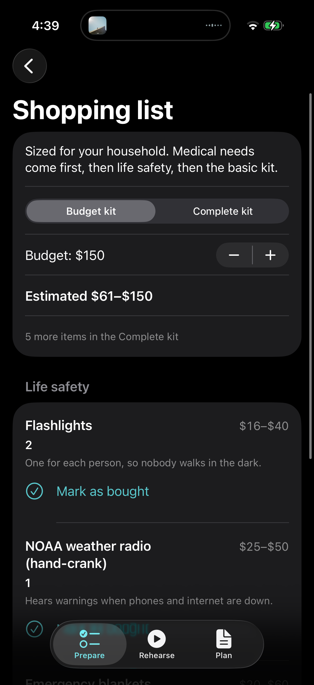</a>
      <br><strong>Shopping list</strong>
      <br>Compare a budget kit with the complete list and track confirmed purchases.
    </td>
    <td align="center" valign="top" width="33%">
      <a href="docs/images/IMG_6852.PNG">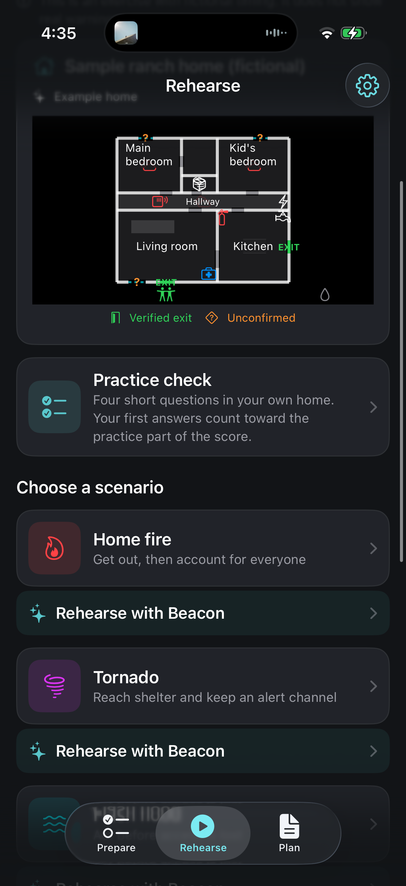</a>
      <br><strong>Choose a rehearsal</strong>
      <br>Open practice checks and hazard-specific scenarios for the household.
    </td>
    <td align="center" valign="top" width="33%">
      <a href="docs/images/IMG_6850.PNG">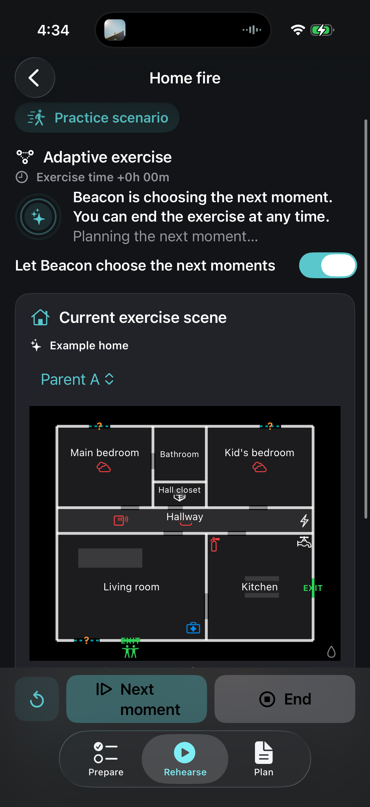</a>
      <br><strong>Adaptive home-fire exercise</strong>
      <br>Beacon prepares the next exercise moment alongside the example floor plan.
    </td>
  </tr>
  <tr>
    <td align="center" valign="top" width="33%">
      <a href="docs/images/IMG_6851.PNG">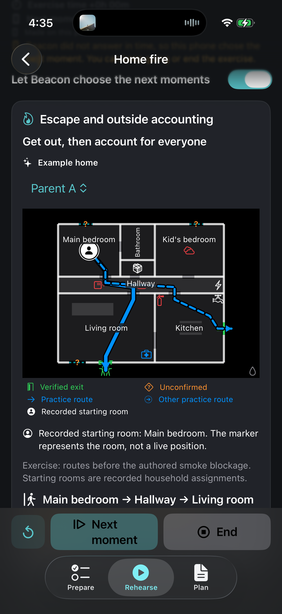</a>
      <br><strong>Escape and accountability</strong>
      <br>Review practice routes from a recorded starting room and plan to account for everyone outside.
    </td>
    <td align="center" valign="top" width="33%">
      <a href="docs/images/IMG_6854.PNG">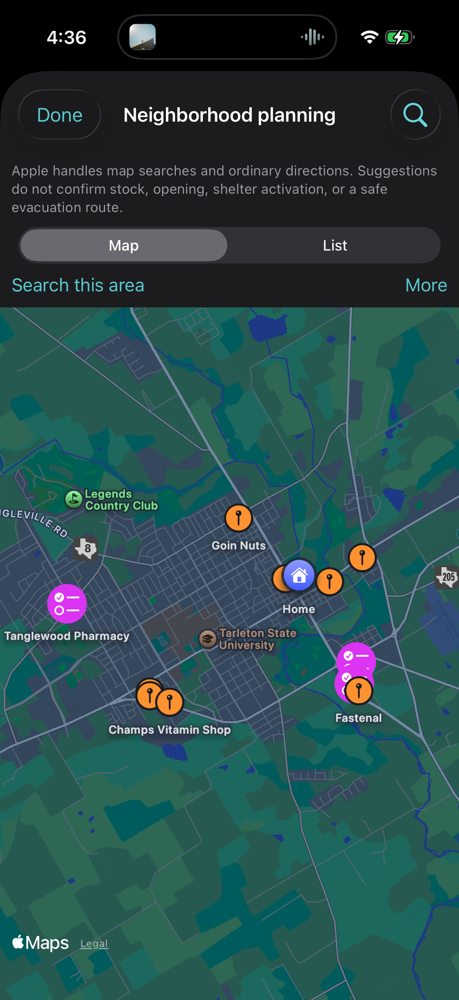</a>
      <br><strong>Neighborhood planning</strong>
      <br>Explore nearby map suggestions and saved places around the home.
    </td>
    <td align="center" valign="top" width="33%">
      <a href="docs/images/IMG_6855.PNG">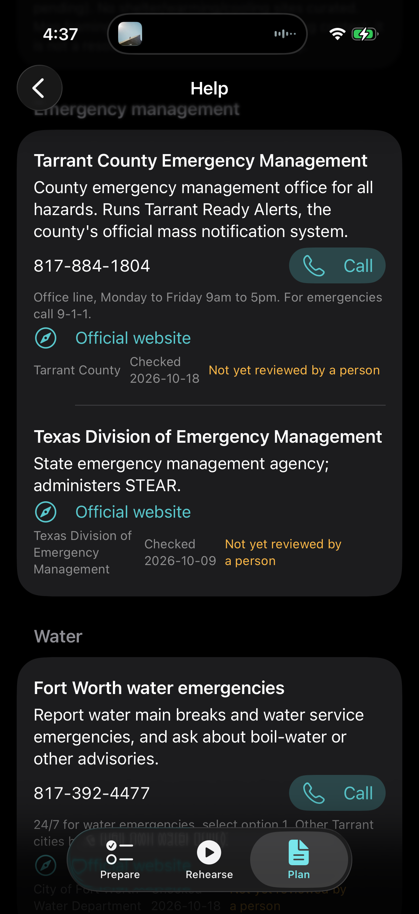</a>
      <br><strong>Official local help</strong>
      <br>Find emergency-management and utility contacts with websites, phone numbers, and source dates.
    </td>
  </tr>
  <tr>
    <td align="center" valign="top" width="33%">
      <a href="docs/images/IMG_6856.PNG">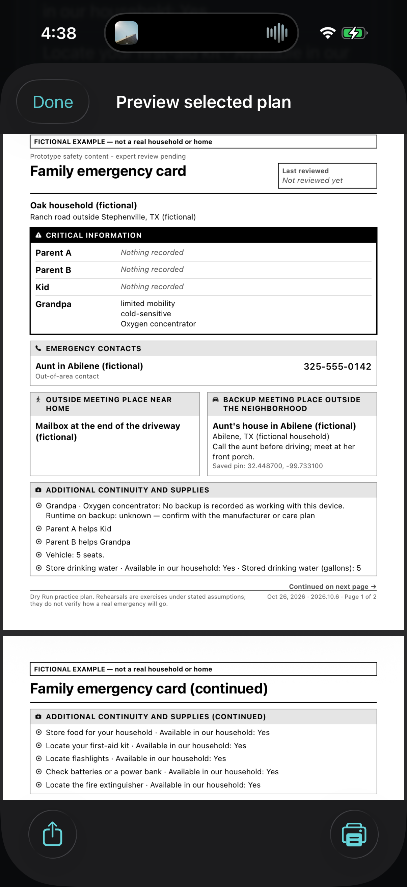</a>
      <br><strong>Printable family card</strong>
      <br>Preview a fictional household’s emergency contacts, meeting places, assistance needs, and supplies.
    </td>
    <td align="center" valign="top" width="33%">
      <a href="docs/images/IMG_6853.PNG">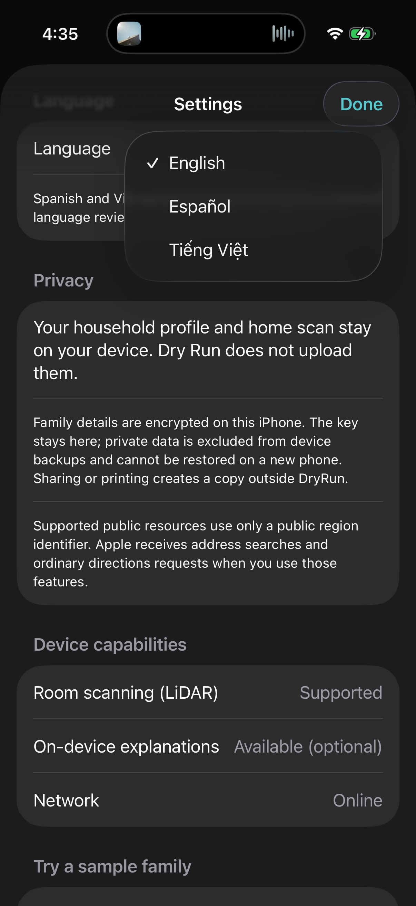</a>
      <br><strong>Language and privacy settings</strong>
      <br>Choose English, Español, or Tiếng Việt and review privacy and device capabilities.
    </td>
  </tr>
</table>

## Build

The iOS app requires macOS, Xcode, and XcodeGen:

```sh
cd apps/ios
xcodegen
open DryRun.xcodeproj
```

Shared Swift code lives in `packages/`. Backend services live in `services/`. Provider keys belong on the server, never in the app.
