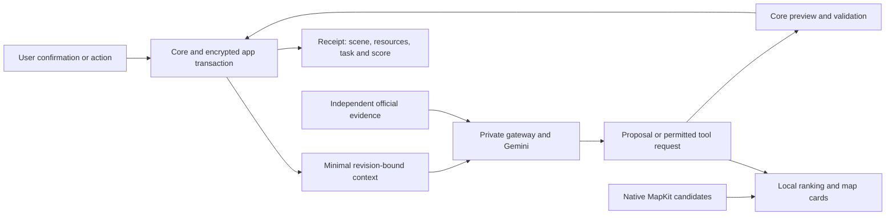

> Corrective implementation update: read [current Mac handoff](mac-corrective-handoff.md), [six-scenario coverage](six-scenario-coverage.md), and [issue status](corrective-issue-status.md) before historical notes below. Current scope includes hazard-mechanics/5 with frozen historical replay, full grounded task generation, automatic research, and retiring fixed-budget hazard anchors. Native and live-quality gates remain separately reported.

# Data flow and authority

User confirmation → InventoryLedger → deterministic gap → source-linked task → ResourceSearchPlan → native map candidate → manual preparation → updated inventory/revisions → controlled stress retest → scorecard. The gateway's proposal never bypasses a local confirmation/save.

A rehearsal action is committed before the director sees its results. The private context includes current `assistance` projected from that receipt (identity/reach/shared-duty summary only); the household snapshot remains the frozen real-world record. An in-exercise helper reassignment never overwrites that record. An approach is not completed assistance; arrivals and `escapeHelperByPersonID` record the actual effects. The director can inspect a preview and compose bounded reviewed incident/pacing commands. It cannot move people, assign helpers, spend supplies or allocate power. Network latency never advances simulated time. Resource depletion interrupts a later requested boundary, and same-time commands use monotonic sequence ordering.

Offline replay reads the initial snapshot and committed log. Timeout/cancellation leaves those values intact; fallback either asks for a decision against that same state or pauses. A fallback is never an authored restart or an implicit default choice. Alternate newly directed exercises are not controlled before/after comparisons.

Truth categories stay separate: user-confirmed facts, scanner geometry/suggestions, official records, provider map data, model observations, hypothetical assumptions, derived findings and real exercise commits. A simulated contact or successful route is not a real-world contact, service activation, readiness check or completed preparation.

Selected-frame calibration now has a local-only `RoomImageCaptureGeometry` companion and bounded optional encrypted `IntegratedAIState.imageGeometryRecords`. [image-geometry.md](image-geometry.md) defines exact transform inversion, camera rays, provenance checks and native byte/registration/deletion responsibilities. Neither the companion nor depth/pose data belongs in cloud contexts; a validated ray is not a world position or confirmed home fact.
